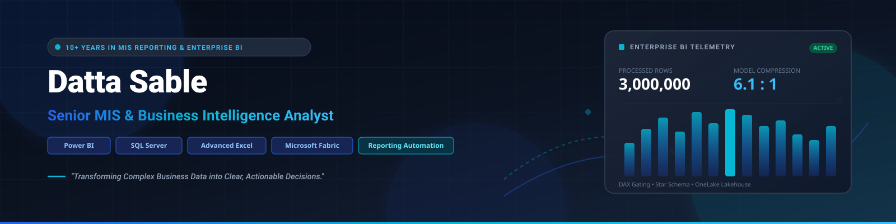



# Datta Sable
### Senior MIS & Business Intelligence Analyst
**Power BI | SQL | Advanced Excel | Microsoft Fabric | Reporting Automation**

  <b>10+ Years in MIS Reporting, BFSI Analytics &amp; Enterprise Business Intelligence</b>

> *"Experienced MIS and Business Intelligence professional specializing in transforming complex business data into actionable insights through Power BI, SQL, Advanced Excel, data modeling, and reporting automation. Building scalable analytics solutions and modern data-driven applications."*

  
  
  
  

  
  
  
  
  
  

---

## 👨‍💼 Professional Overview

With **over a decade of experience** across Management Information Systems (MIS), business intelligence, and enterprise data analytics, I specialize in architecting dependable reporting ecosystems that bridge raw operational records and C-suite decision-making.

- **Enterprise Analytics & Modeling:** Designing clean Kimball star schemas, high-cardinality data models, and performant DAX measure libraries that eliminate reporting discrepancies.
- **BFSI & Operational Collections Exposure:** Extensive background in tracking portfolio risk, bucket movement, delinquency roll rates, recovery pacing, and operational team performance metrics.
- **Reporting Automation:** Modernizing legacy manual reporting workflows into automated SQL transformations and Power Query pipelines, saving hundreds of operational hours per month.
- **Technical Rigor & Governance:** Adhering strictly to truth in data—implementing multi-currency guardrails, disclosing synthetic data limits, and validating reconciliation reports before publishing executive dashboards.

> **Core Philosophy:** *"Transforming Complex Data into Clear Business Decisions."*

---

## 🎯 Core Expertise

<table>
  <tr>
    <td width="50%" valign="top">
      <h3>📊 Business Intelligence</h3>
      <ul>
        <li>Interactive executive dashboards in <b>Power BI</b></li>
        <li>Complex <b>DAX</b> formulas (Time Intelligence, currency context gating)</li>
        <li>Semantic modeling, star schemas, surrogate key design</li>
        <li>Automated dataset refreshes &amp; Power BI service deployment</li>
      </ul>
    </td>
    <td width="50%" valign="top">
      <h3>⚡ Advanced Excel Automation</h3>
      <ul>
        <li>Automated multi-source ETL via <b>Power Query</b></li>
        <li>Advanced dynamic arrays (XLOOKUP, INDEX/MATCH, LET)</li>
        <li>Interactive PivotTables, Power Pivot data models</li>
        <li>Macro and formula-based operational report automation</li>
      </ul>
    </td>
  </tr>
  <tr>
    <td width="50%" valign="top">
      <h3>🗄️ SQL &amp; Data Management</h3>
      <ul>
        <li>Microsoft <b>SQL Server (2022)</b>, SSMS, T-SQL development</li>
        <li>Complex multi-table joins, subqueries, and window functions</li>
        <li>Idempotent DDL/DML transformation scripts &amp; views</li>
        <li>Query optimization, execution plans &amp; columnar indexing</li>
      </ul>
    </td>
    <td width="50%" valign="top">
      <h3>☁️ Microsoft Fabric</h3>
      <ul>
        <li><b>OneLake</b> centralized SaaS architecture</li>
        <li>Lakehouse architecture (Delta Lake tables, Parquet storage)</li>
        <li>Direct Lake semantic model concepts for zero-copy BI</li>
        <li>Preparation for Microsoft Fabric Analytics Engineer workflows</li>
      </ul>
    </td>
  </tr>
  <tr>
    <td width="50%" valign="top">
      <h3>🏦 BFSI &amp; Operational Analytics</h3>
      <ul>
        <li>Loan portfolio monitoring &amp; collections bucket movement</li>
        <li>Delinquency tracking, recovery pacing &amp; agent productivity</li>
        <li>Financial waterfall modeling (Revenue, Cost, Profit Margins)</li>
        <li>Fulfillment monitoring, cancellation tracking, status exceptions</li>
      </ul>
    </td>
    <td width="50%" valign="top">
      <h3>🛠️ Analytics Engineering</h3>
      <ul>
        <li>Multi-stage staging-to-reporting physical data pipelines</li>
        <li>Data quality scorecards, anomaly profiling, defect disclosure</li>
        <li>Surrogate key generation resolving entity mapping collisions</li>
        <li>Automated testing suites verifying relational integrity</li>
      </ul>
    </td>
  </tr>
</table>

---

## 📊 Featured Business Intelligence Projects

<table width="100%">
  <tr>
    <td width="50%" valign="top">
      <h3>🌐 <a href="https://github.com/sabledattatray/enterprise-global-business-analytics-3m">Enterprise Global Business Analytics — 3M Records</a></h3>
      <b>Large-Scale SQL Server &amp; Power BI Data Engineering Pipeline</b>
        
      An enterprise-grade, audit-first portfolio processing <b>3,000,000 synthetic transactions (1.21 GB raw data)</b> through SQL Server 2022 into a Kimball Star Schema and Power BI Desktop.
        
      <b>Verified Capabilities:</b>
      <ul>
        <li><b>3,000,000 rows</b> profiled, typed, and normalized in SQL Server</li>
        <li><b>P0 Multi-Currency Governance:</b> Enforces strict DAX guardrails isolating 42 local currencies to prevent arithmetic distortion</li>
        <li><b>6.1 : 1 VertiPaq compression</b> (1.30 GB CSV to 214 MB model)</li>
        <li><b>414 ms</b> monthly aggregation query benchmark on 3M records</li>
      </ul>
       
      
      
    </td>
    <td width="50%" valign="top">
      <h3>📈 <a href="https://github.com/sabledattatray/enterprise-power-bi-dashboard">Enterprise Power BI Analytics Dashboard</a></h3>
      <b>Nine-Page Executive &amp; Operational Analytics Solution</b>
        
      A comprehensive multi-page Power BI dashboard suite designed for operational transparency, product Pareto analysis, channel distribution, and financial health monitoring.
        
      <b>Verified Capabilities:</b>
      <ul>
        <li><b>Nine structured report pages:</b> Executive, Sales, Product, Channel, Region, Orders, Profitability, Exceptions, and Forecasting</li>
        <li>Corporate light design system with glowing digital globe canvas</li>
        <li>Single-direction <code>1:*</code> relationships eliminating ambiguous filter paths</li>
        <li>Drill-through transaction reconciliation across 19 fact dimensions</li>
      </ul>
       
      
      
    </td>
  </tr>
  <tr>
    <td width="50%" valign="top">
      <h3>⚡ <a href="https://github.com/sabledattatray/nexusbi-excel-dashboard-generator">NexusBI — Excel Dashboard Generator</a></h3>
      <b>Automated Browser-Based Spreadsheet Analytics Platform</b>
        
      A modern analytics tool designed to transform raw Excel workbooks and CSV files into polished, interactive business intelligence dashboards in seconds.
        
      <b>Verified Capabilities:</b>
      <ul>
        <li><b>Privacy-First Processing:</b> In-browser client-side parsing ensures confidential client data never leaves the local machine</li>
        <li>Automatic column data-type detection, date parsing, and KPI synthesis</li>
        <li>Dynamic visualization generation (Bar, Line, Donut, and Metric Cards)</li>
        <li>Instant report and image export for operational stakeholders</li>
      </ul>
       
      
      
    </td>
    <td width="50%" valign="top">
      <h3>🏢 <a href="https://biexpert.online/">BIExpert — Reporting Automation</a></h3>
      <b>Business Intelligence &amp; Operational Analytics Platform</b>
        
      A centralized platform focused on automated MIS reporting, business intelligence workflows, ETL transformation pipelines, and operational dashboard delivery.
        
      <b>Verified Capabilities:</b>
      <ul>
        <li>Custom MIS reporting workflows reducing operational turnaround time</li>
        <li>Standardized KPI definitions across sales, finance, and logistics</li>
        <li>Relational database integration for executive decision-making</li>
        <li>ETL transformation templates for cross-departmental data feeds</li>
      </ul>
       
      
      
    </td>
  </tr>
</table>

---

## 🚀 Products & Applications

Complementing my core business intelligence portfolio, I build practical software applications and digital solutions:

<table>
  <tr>
    <td width="50%" valign="top">
      <h3>🌐 <a href="https://dattasable.com">dattasable.com</a></h3>
      <b>Professional Portfolio &amp; Analytics Ecosystem</b>
        
      My primary professional portfolio and resource hub showcasing verified business intelligence architectures, technical articles, and analytical products.
        
      
    </td>
    <td width="50%" valign="top">
      <h3>📞 <a href="https://nexdial.io">Nexdial</a></h3>
      <b>Unified Communication &amp; Customer CRM Application</b>
        
      A lightweight, unified customer communications and CRM system designed to streamline contact management and client interaction history for growing teams.
        
      
    </td>
  </tr>
  <tr>
    <td width="50%" valign="top">
      <h3>📄 <a href="https://resumecopilotai.vercel.app">Resume Copilot AI</a></h3>
      <b>AI-Assisted Resume Optimization Application</b>
        
      An AI-powered productivity application designed to help job seekers format, analyze, and optimize resumes for ATS parsing and keyword matching.
        
      
    </td>
    <td width="50%" valign="top">
      <h3>⚡ Modern Web Engineering</h3>
      <b>Full-Stack Analytics Delivery</b>
        
      Building modern web interfaces (Next.js, React, TypeScript, TailwindCSS) to deliver interactive data experiences and custom client portals directly in the browser.
        
      
    </td>
  </tr>
</table>

---

## 🛠️ Technical Skills

| Domain | Core Technologies &amp; Tools |
|---|---|
| **Business Intelligence** | Microsoft Power BI, DAX, Power Query (M), Data Modeling, Report Server |
| **Spreadsheet Analytics** | Microsoft Excel, Power Pivot, Dynamic Formulas (XLOOKUP, LET), PivotTables, VBA |
| **Databases &amp; Warehousing** | Microsoft SQL Server (2022), SSMS, T-SQL, Stored Procedures, Views, PostgreSQL |
| **Data Engineering** | Star Schemas (Kimball), Surrogate Key Architecture, ETL Pipelines, Data Quality Audits |
| **Microsoft Fabric** | OneLake Architecture, Lakehouse, Delta Tables, Direct Lake Concept Exploration |
| **Programming &amp; Scripting**| SQL (Advanced), Python (pandas, openpyxl), PowerShell (Automation) |
| **Web &amp; Application Stack** | Next.js, React, TypeScript, Node.js, TailwindCSS |
| **Analytics Methodologies** | Executive KPI Frameworks, Time Intelligence, Financial Reconciliation, Pareto Analysis |
| **Business Domains** | Banking &amp; Financial Services (BFSI), Collections Analytics, Risk Monitoring, Retail MIS |

---

## 💼 Professional Background

- **10+ Years of Hands-on Experience:** Leading MIS reporting, operational business intelligence, and database analysis across complex business environments.
- **BFSI Collections &amp; Risk Analytics:** Managing loan portfolio health tracking, vintage analysis, roll-rate matrix generation, and field agent performance scorecards.
- **Executive Decision Enablement:** Designing C-suite dashboards that summarize multimillion-row datasets into actionable variances, fulfillment rates, and unit volumes.
- **Data Governance &amp; Integrity:** Establishing verification standards that detect and disclose source data defects, preventing misleading cross-currency or collided entity figures.
- **Cross-Functional Coordination:** Collaborating with operations, finance, IT, and external stakeholders to translate ambiguous business requirements into automated, single-source-of-truth reporting.

---

## 📚 Microsoft Fabric & Technical Resources

As part of my commitment to continuous technical growth and sharing knowledge with the community:

- 📓 **[DP-600 Study Companion Notebook](https://github.com/sabledattatray/dp600-study-companion-notebook):** A structured public GitHub repository documenting concepts, exercises, and study notes for the Microsoft Fabric Analytics Engineer curriculum (Exam DP-600).
- 📰 **[Microsoft Fabric Technical Articles](https://fabric.dattasable.com/):** Deep-dive articles exploring OneLake architecture, Lakehouse vs. Warehouse patterns, and Direct Lake advantages.
- ✍️ **[Technical Insights & Blog](https://dattasable.com):** Regular articles on Power BI best practices, DAX performance optimization, SQL transformations, and reporting automation.

> *Note: Study notebooks and articles represent active learning and technical resources created to support the analytics community.*

---

## 📈 GitHub Activity

<table width="100%">
  <tr>
    <td width="50%" align="center" valign="middle">
      
    </td>
    <td width="50%" align="center" valign="middle">
      
    </td>
  </tr>
</table>

> *Language statistics reflect repository source code distribution across public repositories and complement primary expertise in Power BI, SQL, and Advanced Excel.*

---

## 🤝 Work With Me

I am open to discuss **Senior MIS, Business Intelligence Analyst, Power BI Developer, and Analytics Consulting opportunities** (Remote, International, and Hybrid):

- **Power BI Solutions:** End-to-end dashboard development, DAX optimization, data modeling, and executive report design.
- **Excel &amp; MIS Automation:** Transforming complex, manual spreadsheet processes into automated, zero-error Power Query and SQL pipelines.
- **Enterprise Reporting Frameworks:** Structuring single-source-of-truth KPIs, collections analytics, and operational metrics.
- **Data Engineering &amp; Preparation:** Cleaning, remodeling, and auditing large datasets for reliable business consumption.

### Let's Connect:
- 🌐 **Portfolio &amp; Case Studies:** [https://dattasable.com](https://dattasable.com/)
- 💼 **LinkedIn Profile:** [linkedin.com/in/dattasable](https://www.linkedin.com/in/dattasable/)
- 📧 **Direct Professional Email:** [ds@dattasable.com](mailto:ds@dattasable.com)

---

  
<b>Transforming Data into Decisions.</b>

  
<small>© 2026 <a href="https://dattasable.com">Datta Sable</a> • All Rights Reserved</small>

